# UTS PBO: CRUD Inventaris Laptop (Laravel 13)

Aplikasi web **Inventaris Laptop** untuk UTS mata kuliah **Pemrograman Berorientasi Objek**. Studi kasusnya melanjutkan **Sistem Jual Beli Laptop**. Aplikasi mengelola data persediaan laptop dengan pola **Route → Controller → Blade**.

---

## Screenshot Proses CRUD

| Daftar laptop | Form tambah |
| :-: | :-: |
| 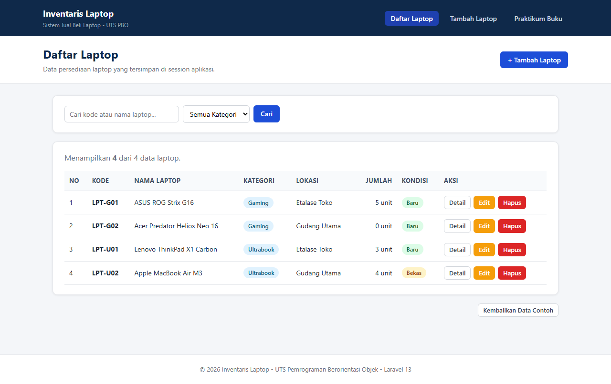 | 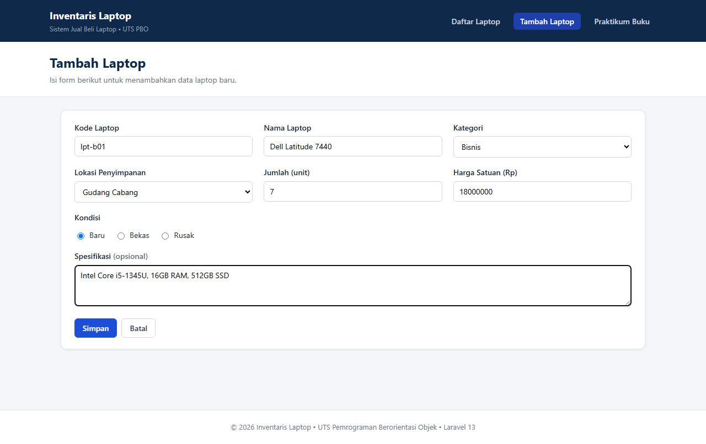 |
| **Tambah berhasil** | **Validasi gagal (kode duplikat)** |
| 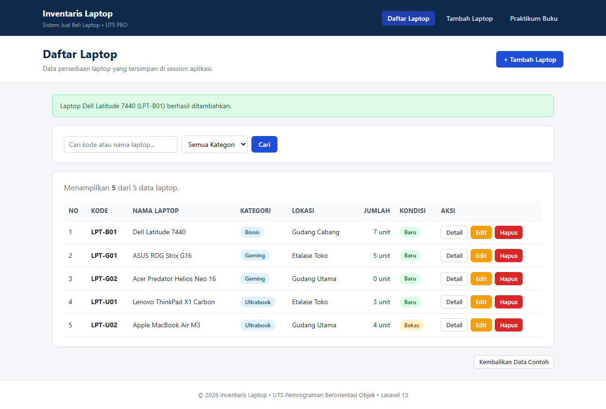 | 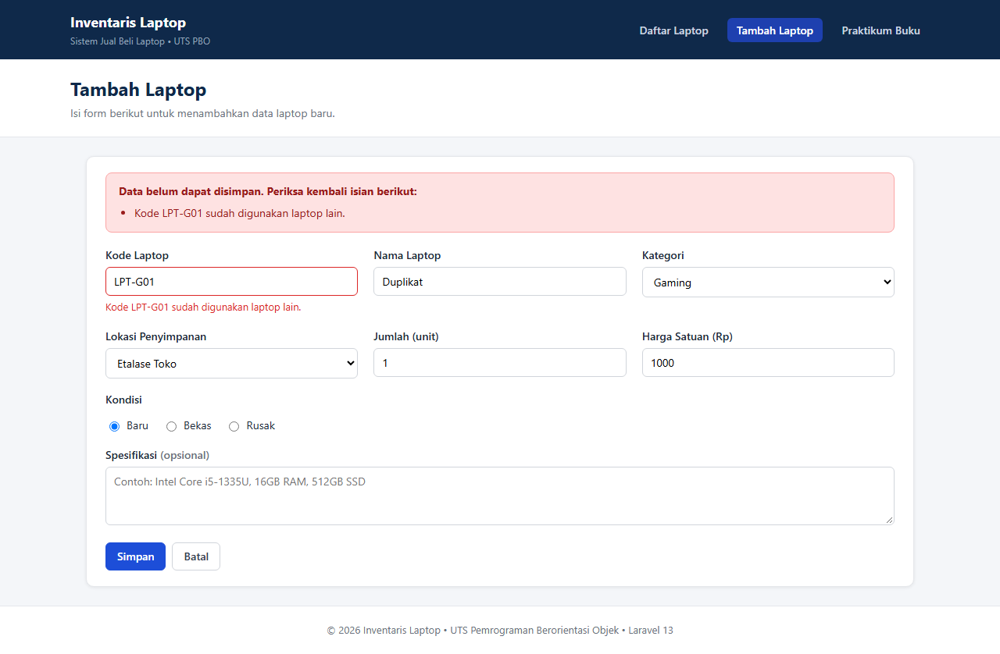 |
| **Detail laptop** | **Form edit (nilai lama)** |
| 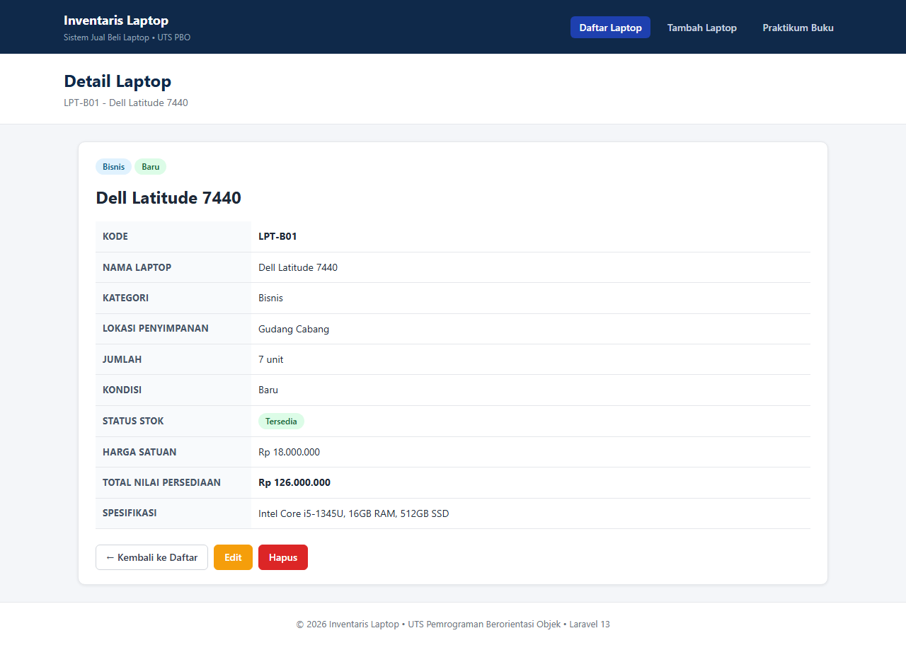 | 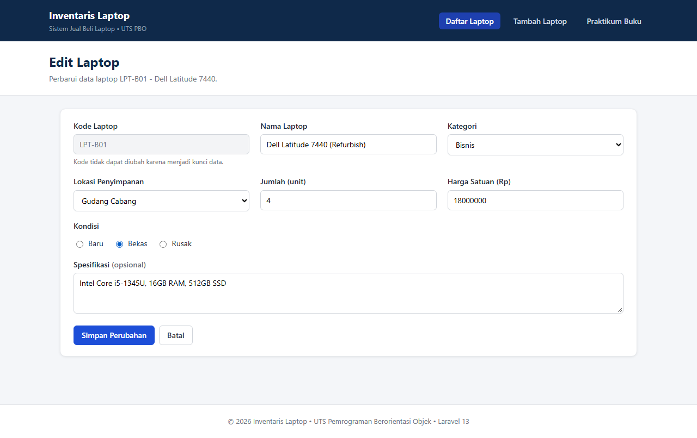 |
| **Edit berhasil** | **Pencarian** |
| 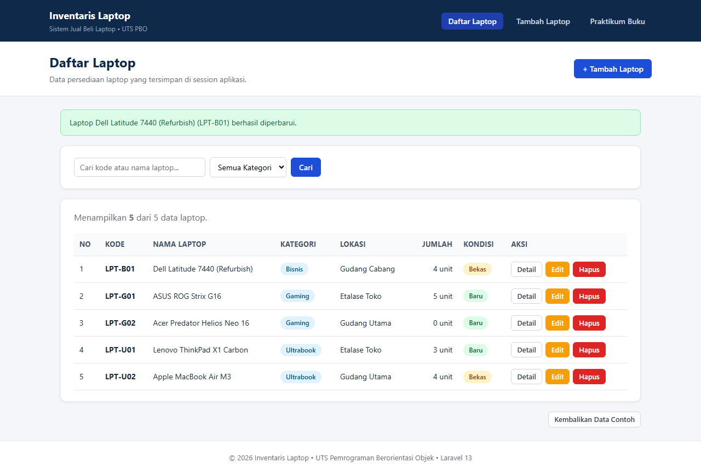 | 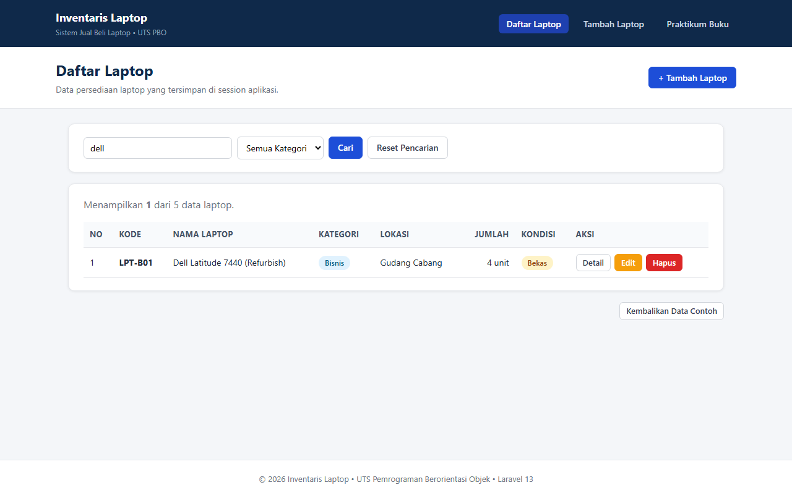 |
| **Hapus berhasil** | **Kode tidak ditemukan** |
| 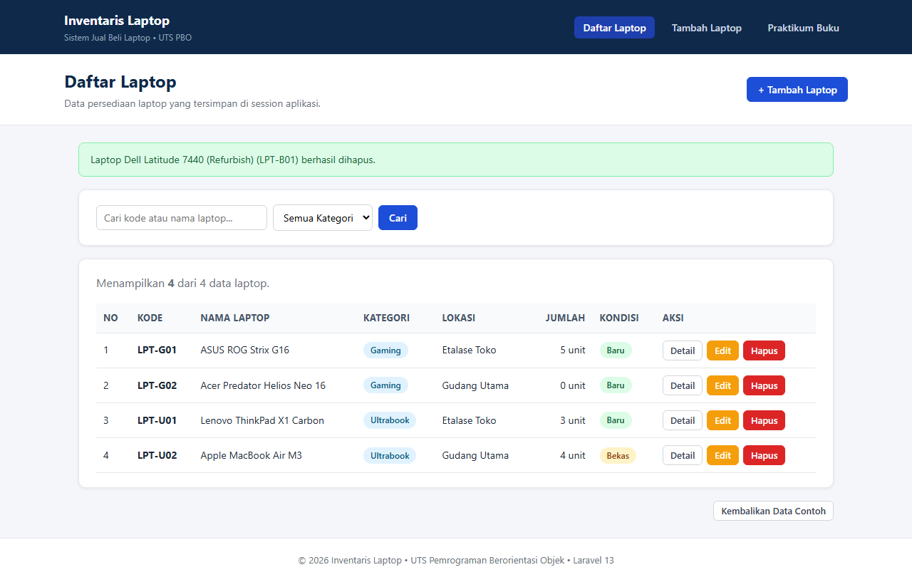 | 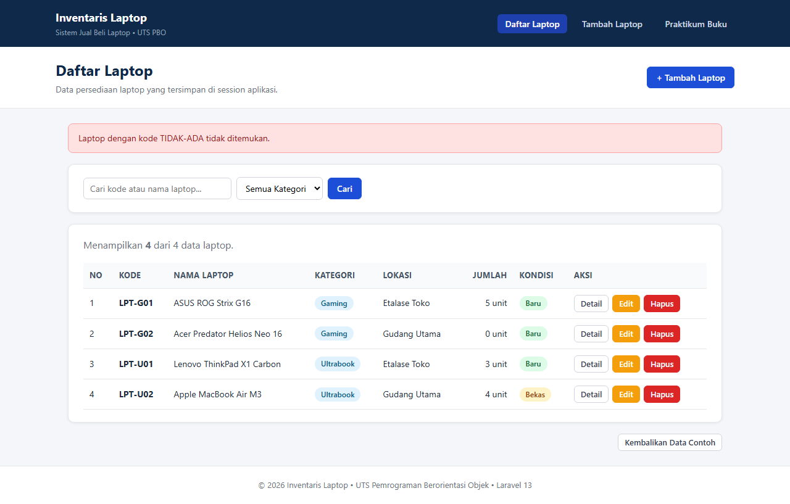 |
| **Data belum tersedia** | |
| 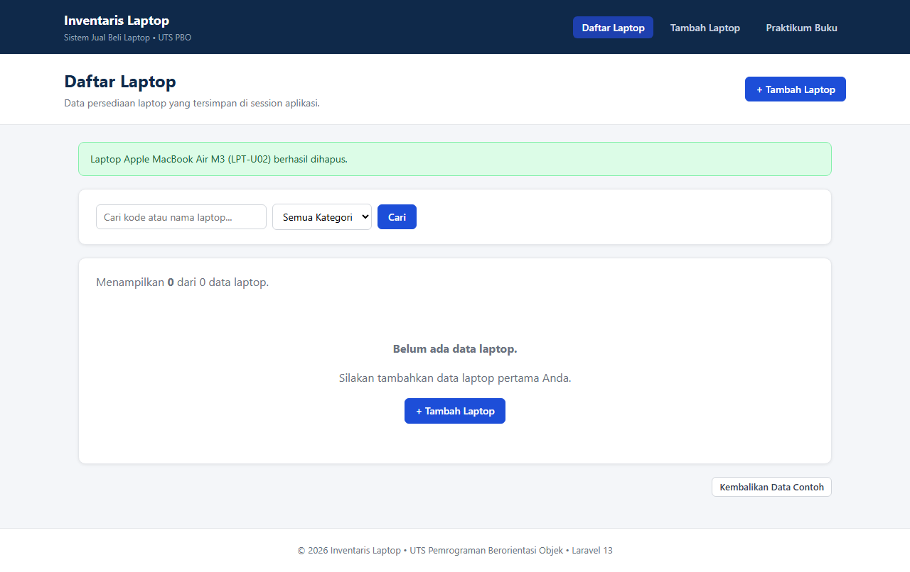 | |

---

## Cara Menjalankan

Prasyarat: PHP 8.3+ dan Composer 2.

```bash
git clone https://github.com/Muhayara/Simple-Inventaris-Laptop.git
cd Simple-Inventaris-Laptop
composer install
cp .env.example .env          # SESSION_DRIVER=file sudah diatur di .env.example
php artisan key:generate
php artisan serve
```

Buka `http://127.0.0.1:8000/laptop`.

Tugas pertemuan 7 yang belum sempat upload: [laravel-katalog-laptop-mvc](https://github.com/Muhayara/laravel-katalog-laptop-mvc)
